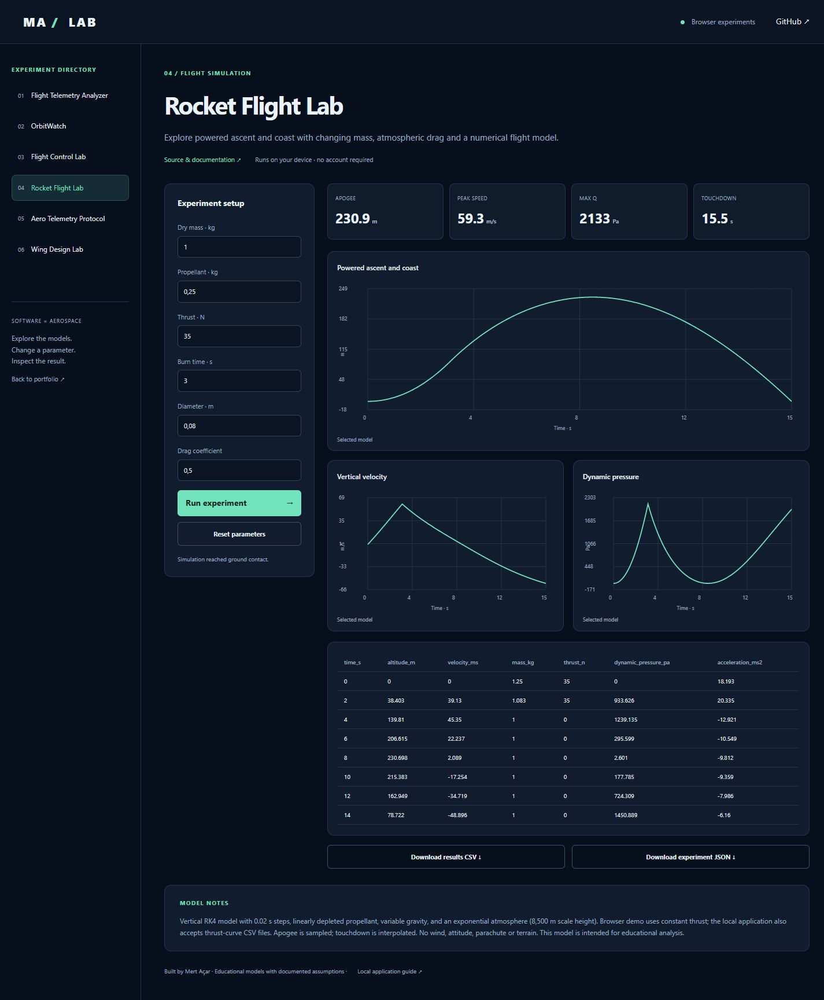

# Rocket Flight Lab

[Live browser demo](https://mertacar-git.github.io/rocket-flight-lab/) · [Portfolio laboratory](https://mertacar-git.github.io/portfolio/lab/index.html?project=rocket-flight-lab)

<details>
<summary>Actual application screenshot</summary>



</details>

## Browser and local editions

The public browser demo runs JavaScript models on-device. The local application uses Python and Streamlit. JavaScript numerical/protocol outputs are checked against committed Python reference fixtures. Satellite.js 6.0.1 is bundled with its license; no runtime CDN is required. Uploaded CSV data is processed locally in the browser.

Browser orbit crossings use sampling and bisection, with sampled culmination times; local Skyfield uses its event search. Browser rocket inputs use constant thrust; local Python also supports uploaded thrust curves. Browser wing coefficients are fixed to CD0=0.025 and CLmax=1.2; local Python exposes these and a span sweep. Browser telemetry has CSV/JSON analysis; local Python additionally groups alert intervals.

```sh
node --test docs/models.test.cjs
```

Serve `docs/` with any static server to run the browser edition locally. Example: `python -m http.server 8000 --directory docs`. Open http://localhost:8000.

## Model and features

- Vertical RK4 integration with changing mass, variable gravity and an exponential density model.
- Constant thrust or an uploaded piecewise-linear thrust curve (`time_s,thrust_n`). Curve must begin at zero and end at the chosen burn time.
- Configurable dry/propellant mass, diameter, drag, burn duration and flight time limit.
- Ground hold until lift-off; interpolated touchdown; sampled apogee, peak speed and max dynamic pressure.
- CSV flight records and JSON experiment exports.

Mass depletion is linear in burn time, independent of thrust-curve shape. No wind, attitude, recovery, terrain or structural model is included. The atmosphere is a scale-height approximation, not a full standard atmosphere. Burnout discontinuities are handled by splitting integration steps. Touchdown velocity is interpolated, with no impact dynamics. These assumptions are for an educational model.

Tests compare constant-mass, drag-free ascent against the analytic result, compare timesteps and check curve equivalence, mass bounds, no-lift-off and landing.


Educational aerospace/software project with an interactive application and validated core.

## Run locally

Python 3.12 recommended.

```sh
python -m venv .venv
# Windows: .venv\Scripts\activate
# macOS/Linux: source .venv/bin/activate
python -m pip install -r requirements.txt
python -m streamlit run app.py
```

## Test

```sh
python -m unittest discover -v
```

MIT licensed. Built with AI assistance; see the documented model and test assumptions before extending.
